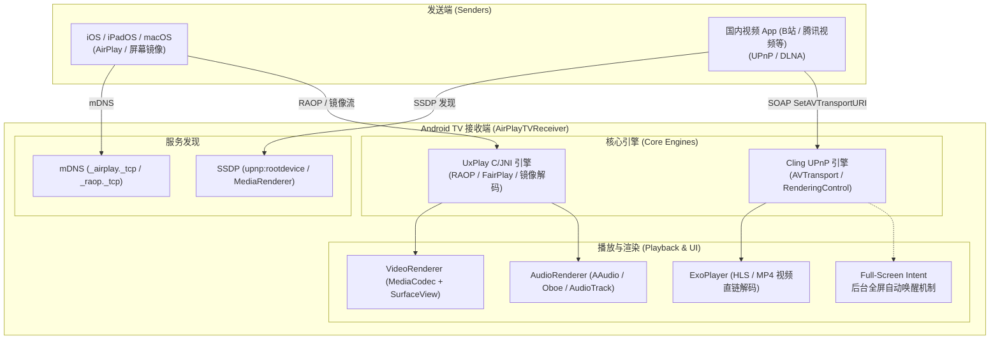

# AirPlay & DLNA TV Receiver for Android

[](LICENSE)
[-green.svg)]()

专为 Android / Android TV 设计的高性能双协议无线投屏接收端，同时支持 **Apple AirPlay**（屏幕镜像 / 音频 / 视频）与 **UPnP / DLNA MediaRenderer**（B 站、腾讯视频、爱奇艺、优酷等 App 内 TV 投屏），双服务独立并行、互不干扰。

---

## 🌟 核心特性 (Key Features)

### 1. 双协议并行投屏
- **AirPlay 2 接收端**：基于 [UxPlay](https://github.com/FDH2/UxPlay) 底层协议库与 JNI 桥接，支持 iPhone、iPad、Mac 的屏幕镜像、视频推送以及高质量音频播放（ALAC / AAC-ELD / AAC-LC）。
- **UPnP / DLNA MediaRenderer**：集成 Cling UPnP 架构与 AVTransport / RenderingControl 服务，广播 `MediaRenderer` 设备，主流国内音视频 App（哔哩哔哩、腾讯视频、爱奇艺等）秒搜秒投。

### 2. 电视端体验深度优化
- **开机自启与常驻**：支持 `BOOT_COMPLETED` 开机广播自动拉起界面，遥控器返回键平滑退入后台不销毁，保证渲染 `Surface` 随时就绪。
- **后台全屏呼叫唤醒（Full-Screen Intent）**：解决 Android 10/11+ 后台 Activity 启动拦截机制，即便在电视桌面或其他应用中，一旦收到投屏信号立刻自动弹到前台全屏播映。
- **电视遥控器交互适配**：支持 D-Pad 方向键控制、自动全屏、屏幕常亮保活与简洁无干扰 UI。
- **高性能硬件解码**：支持 H.264 与 H.265 (HEVC) 硬件实时解码与自适应帧率控制，低延迟低抖动。

---

## 📐 系统架构 (Architecture)



---

## 🛠️ 编译与安装 (Build & Install)

本项目基于 Gradle 与 CMake 构建原生 C/C++ 组件。

### 1. 初始化依赖与子模块
```bash
git submodule update --init --recursive
```

### 2. 构建 Debug APK
```bash
./gradlew assembleDebug
```

生成安装包位于：`app/build/outputs/apk/debug/app-debug.apk`。

### 3. 安装到 Android TV 设备 (ADB)
```bash
adb connect <TV_IP>:5555
adb install -r app/build/outputs/apk/debug/app-debug.apk
```

---

## 📺 运行环境与兼容性 (Compatibility)

- **Android 系统**：Android 7.0 (API 24) 及以上，完美适配 Android 11+ Google TV。
- **网络要求**：电视与发送端设备处于同一局域网（同一 Wi-Fi 或交换机），网络需支持多播（Multicast / mDNS）。

---

## 📄 开源许可 (License)

本项目遵循 [GPLv3 许可证](LICENSE)。

## 🙏 致谢 (Credits)

- [UxPlay](https://github.com/FDH2/UxPlay) - AirPlay / RAOP 核心协议实现
- [Cling](https://github.com/4thline/cling) - UPnP / DLNA 核心协议栈
- [ExoPlayer / Media3](https://github.com/androidx/media) - 现代化流媒体播放引擎
- [FFmpeg](https://ffmpeg.org) - 无损音频解码支持
